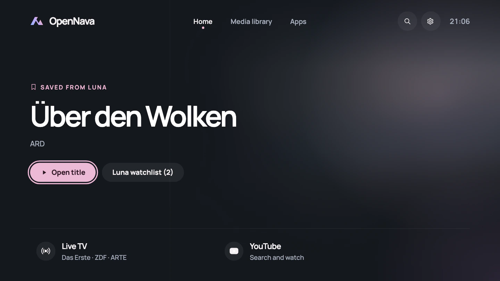

# OpenNava

A home screen for Android TV, Google TV and Android-based Fire TV. Choose a full launcher for apps, YouTube and German broadcaster libraries, or a senior view that puts live channels, catch-up and recordings one press away.

**[Try the TV in your browser](https://opennava.site/#preview)** · **[Download the TV app](https://github.com/fcore247/opennava/releases/latest/download/OpenNava.apk)** · **[Download the Android companion](https://github.com/fcore247/opennava/releases/latest/download/OpenNava-Companion.apk)**

[](https://opennava.site/?profile=full#preview)

## Choose your home screen

| | Full launcher | Senior view |
| --- | --- | --- |
| **Home** | Featured programme, live channels, installed apps and search | Five large buttons for ARD, ZDF, ARTE, live TV and recordings |
| **Watching** | Browse broadcaster catalogues and integrated YouTube, or open an installed app | Start a channel, find a show in a library, check the TV guide or replay a saved programme |
| **Navigation** | App shortcuts and quick settings | Large focus outlines, an on-screen keyboard and hands-on remote-control lessons |
| **Try it** | [Explore the full launcher](https://opennava.site/?profile=full#preview) | [Explore the senior view](https://opennava.site/?profile=senior#preview) |

Both profiles ship in one TV APK. On the interactive website, open **Live TV** in senior view or choose a station in the full launcher to watch its available public broadcast. The guide shows German programme listings. On-demand library previews use sample footage. On a television, the app also searches the broadcasters’ catalogues and pairs with the optional Android companion.

**[Everyday user guide](guide/USER_GUIDE.md)** · **[How the project fits together](guide/ARCHITECTURE.md)** · **[Maintainer guide](guide/MAINTAINING.md)**

## Optional tools

| Tool | Download | What to read first |
| --- | --- | --- |
| **OpenNava Studio** | [Mac app ZIP](https://github.com/fcore247/opennava/releases/download/tools-v1.0.0/OpenNava-Studio-macOS.zip) | An ad-hoc signed macOS remote for working with an authorized television. [Studio guide](macos/README.md) |
| **Fire TV key helper** | [Signed helper APK](https://github.com/fcore247/opennava/releases/download/tools-v1.0.0/OpenNava-Fire-Keys.apk) | Optional physical remote shortcuts for compatible Android-based Fire TV devices. [Fire TV setup](android/fire-keys/README.md) |

## Set it up with your AI agent

Give one of these requests to a coding agent with terminal access to your computer. Your agent can guide you through the steps that need a button press on the TV.

- **Full launcher** — “Set up OpenNava's full launcher on my TV using [the setup instructions](https://github.com/fcore247/opennava/blob/main/AGENTS.md#full-launcher). Use profile `full`.”
- **Senior view** — “Set up OpenNava's senior view on my TV using [the setup instructions](https://github.com/fcore247/opennava/blob/main/AGENTS.md#senior-view). Use profile `senior`.”

Add “Install the companion on my Android phone” to include a phone. Add “Make OpenNava my Home app” to request the Android Home role. The selected profile can be changed later by running setup again with the other profile.

## Connect your devices

You need Python 3.8 or newer and Android SDK Platform Tools (`adb`) on the computer. The TV app targets Android-based Google TV, Android TV and Fire TV devices running Android API 26 or newer. The companion requires Android 11 or newer. Fire TV devices that run Vega OS use a different app platform. [Download Google's Platform Tools](https://developer.android.com/tools/releases/platform-tools)

1. **Google TV / Android TV.** In Settings → System → About, press the Android TV OS build entry seven times to enable developer options. Under Developer options, open Wireless debugging if the device offers it. Choose **Pair device with pairing code**. On the computer run `adb pair HOST:PAIRING_PORT`, then enter the code at the prompt. Back on the main Wireless debugging screen, read its **IP address & port** and run `adb connect HOST:CONNECTION_PORT`. The two ports can differ. [Google's ADB pairing guide](https://developer.android.com/tools/adb#wireless)
2. **Android-based Fire TV.** In Settings → My Fire TV → Developer Options, enable ADB Debugging. If developer options are hidden, select the device name under About seven times. Find its address in About → Network, then run `adb connect HOST:5555`. Approve the computer on the TV. [Amazon's Fire TV connection guide](https://developer.amazon.com/docs/fire-tv/connecting-adb-to-device.html)
3. **Optional Android phone.** Enable developer options and USB debugging, connect the phone by USB, unlock it and accept this computer's debugging prompt. You can also use Android's wireless pairing procedure. [Android developer options](https://developer.android.com/studio/debug/dev-options)

Start on the same local network. An already configured private VPN such as Tailscale can also carry a reachable TV connection. Keep ADB on private addresses and leave the pairing code on the device or in the local terminal prompt.

## Install from the terminal

Clone the repository and inspect the connected devices.

```sh
git clone https://github.com/fcore247/opennava.git
cd opennava
python3 tools/setup.py --list
```

Choose **one** profile. Replace the uppercase placeholders with exact serials from the list, including the port when shown.

```sh
python3 tools/setup.py --profile full --tv TV_SERIAL
```

```sh
python3 tools/setup.py --profile senior --tv TV_SERIAL --phone PHONE_SERIAL
```

If there is exactly one eligible TV, you may omit `--tv`. To install just the phone app, use `python3 tools/setup.py --phone-only --phone PHONE_SERIAL`. Add `--dry-run` to preview. For a download you already have, put the official APKs together in a directory and pass `--assets-dir DIRECTORY`.

Setup verifies the chosen release's APK SHA-256 against [release.json](release.json), installs for the active Android user and checks the installed version. It asks the TV to persist the requested profile and reads the setting back. It keeps existing OpenNava data when updating. If Android reports a different signing certificate, stop and inspect the installed app before choosing how to handle its data.

**Default Home.** The commands above open OpenNava. To request the Android Home role, add `--set-home` to the TV setup command. The installer reports the previous Home component and checks Android's resolved Home activity. Press Home once to test the actual remote. Some vendor firmware reserves the Home button. On those devices, open OpenNava under Apps.

**Go back.** Select the previous launcher under the device's default Home app settings, or run the restore command printed by `--set-home`. Open Apps to launch OpenNava again. To remove it, use Android Settings → Apps → OpenNava → Uninstall after restoring the previous Home app. Android removes OpenNava's local data when uninstalling.

**Pair the phone remote.** Choose **Pair phone** in the full launcher, then **Menu → Connection → Scan QR code** on the phone. You can also enter the TV’s private address manually. The phone establishes its own ADB identity. Complete its pairing or authorization prompt on the TV. [Pairing walkthrough](guide/USER_GUIDE.md#pair-an-android-phone)

## Updates

Android handles updates in place using the existing OpenNava signing identity. The [release page](https://github.com/fcore247/opennava/releases/latest) includes `SHA256SUMS` and the machine-readable `update.json`.

### Update on the TV or phone

Open **Software updates** inside OpenNava or the companion to check for a release. Automatic checks are enabled by default. Android schedules them when the device is idle and connected. Each app verifies the release and asks Android to install it. Depending on the Android version and how the app was first installed, you may need to allow installs from this source or confirm the Android installation prompt. Turn off **Automatic updates** on that screen to opt out on that device.

### Update from your computer

For unattended updates, install Android SDK **Build Tools** (for `apksigner` and `aapt`) and a Java runtime on the computer that has ADB access. Set `ANDROID_HOME` to the SDK or add its build-tools and platform-tools directories to `PATH`. [Android SDK Manager](https://developer.android.com/tools/sdkmanager)

```sh
python3 tools/update.py --tv TV_SERIAL --phone PHONE_SERIAL --check
python3 tools/update.py --tv TV_SERIAL --phone PHONE_SERIAL
```

Each target is optional. The updater only touches an already installed package when the official release has a higher version code. Before installing, it checks the APK hash, actual package and version, and the verified APK signing certificate against the [pinned OpenNava fingerprint](release-key.sha256). An update keeps the selected profile, settings and recordings.

### Hourly updates

On macOS or a Linux desktop with a systemd user manager, run this once while the intended devices are connected.

```sh
python3 tools/update.py --install-timer --tv TV_SERIAL --phone PHONE_SERIAL
```

The per-user job stores a local copy of its updater and enrolled Android identities. It checks hourly while that user and computer can run the job, reconnects enrolled network addresses and tries again later for offline devices or apps in use. Removing and re-enrolling an Android user, or changing the TV's address or port, requires running the enrollment command again. Re-run it from a newer checkout to refresh the updater itself. Remove the job with `python3 tools/update.py --remove-timer`.

On macOS, logs are in `~/Library/Logs/OpenNava/`. On Linux, use `journalctl --user -u site.navatv.updates.service`. On Windows, Task Scheduler can periodically run your Python executable with the full path to `tools/update.py --scheduled --tv TV_SERIAL`. Keep that checkout available and set the SDK tools on the scheduled task's account.

## Build from source

The Android build produces both the launcher APK and the companion APK. The companion includes the matching TV package for transfer to an authorized television. The build guide lists the SDK, JDK, pinned media dependencies and signing steps. [Android build guide](android/BUILD.md)

| Component | Source and documentation |
| --- | --- |
| TV launcher, native player, live guide and recordings | [Android TV](android/tv/) |
| Android phone companion | [Android companion](android/companion/) |
| OpenNava Studio for macOS | [Mac remote and build instructions](macos/README.md) |
| Optional Fire TV remote shortcuts | [Fire TV key helper](android/fire-keys/README.md) |
| Interactive website and custom domains | [GitHub Pages source](docs/) · [Legacy domain redirect](hosting/legacy-redirect/README.md) |
| Installation, verification and release tooling | [Tools](tools/) · [Maintainer guide](guide/MAINTAINING.md) |

For publishing, follow the maintainer guide to prepare the signed files, commit the release manifest and verify GitHub's uploaded assets. Contributors can follow the architecture guide from a TV or phone action to the code that handles it. [Release and maintenance](guide/MAINTAINING.md) · [Architecture](guide/ARCHITECTURE.md)

## Credits

NavaOS inspired me to build OpenNava. [Explore NavaOS](https://navaos.site/os/)

OpenNava uses SmartTube, MediaServiceCore and SharedModules for its integrated YouTube playback. Its Android apps also use AndroidX Media3, ZXing and the companion's ADB transport. The notices credit these projects, the typefaces and the visual assets, and link their individual licenses. [SmartTube](https://github.com/yuliskov/SmartTube) · [Pinned player sources](android/player/source-pins.json) · [Third-party notices and artwork](android/NOTICE.md)
