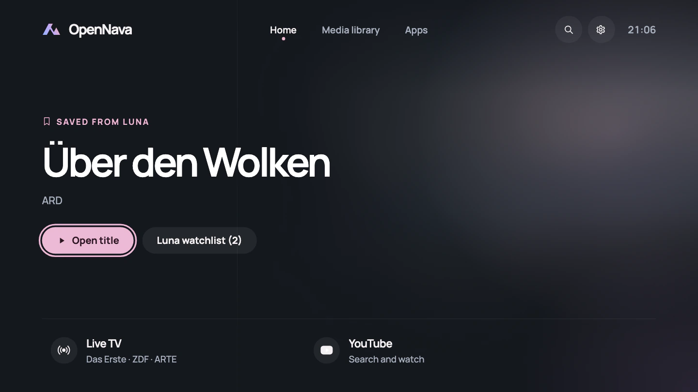
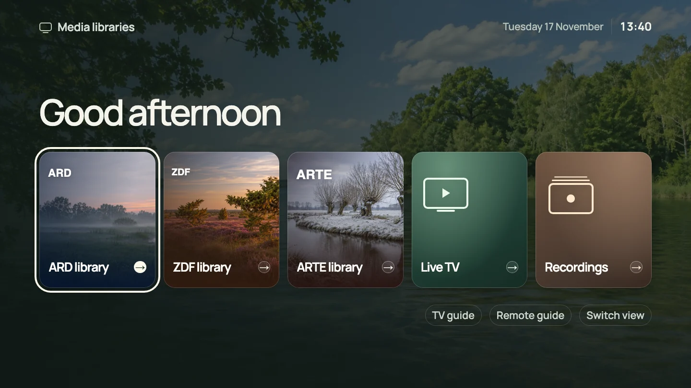
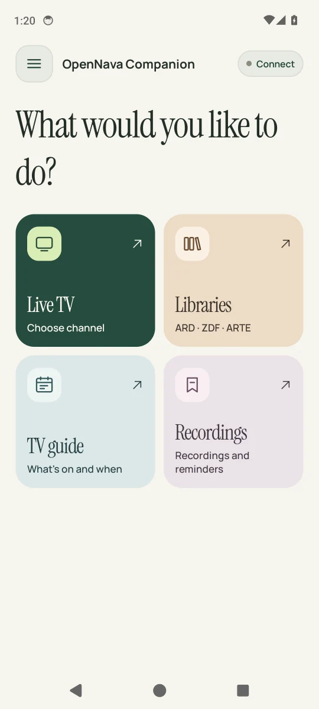

# Watching with OpenNava

Choose the home screen that suits the person holding the remote. Both profiles share the same TV installation. The optional phone app can browse programmes and control playback on a paired television.

[Try the interactive TV](https://opennava.site/#preview) · [Installation and downloads](../README.md#set-it-up-with-your-ai-agent) · [Live remote controls](#live-tv-remote-controls) · [Pair an Android phone](#pair-an-android-phone)

## Full launcher

The preview opens on **Home**. **Open title** takes you to your latest Luna programme. If the watchlist is empty, **Watch now** opens the featured programme when one is available. Use the **Live TV** shortcut at the bottom to start watching a channel or **YouTube** to search for a video. During live playback, hold **Down** to open the channel list.

In the top bar, **Media library** opens the broadcaster catalogues and integrated YouTube. Choose **Filters** to narrow the selection. **Apps** shows the apps installed on your TV. The search icon opens search and **Settings** includes **Pair phone** and **Senior view**.

In the stable release, the same areas are reached through **For you**, **All apps**, the search icon and the **YouTube** section.

*The screenshots show the interactive demo with sample programmes. Your installed launcher loads its own channels, listings and installed apps.*

### Save a programme from Luna Browser

This feature requires the Luna Browser and OpenNava TV preview builds. Install Android SDK Platform Tools on the computer running Luna and connect the computer and Fire TV to the same private network. To try the flow on one screen, use the [interactive Luna and OpenNava demo](https://opennava.site/#demo).

1. On the Fire TV, enable **ADB Debugging** under **Settings → My Fire TV → Developer Options**. Read the stick’s IP address under **About → Network**. [Fire TV connection instructions](../README.md#connect-your-devices)
2. In Luna, open **⋯ → OpenNava watchlist**. Choose **Connect by TV IP address**, enter the Fire TV’s private address and click **Connect to address**. Luna uses port 5555 unless you specify another port.
3. Approve the connection on the Fire TV and select that stick in Luna’s device list. **Find a TV** refreshes the list and also shows TVs already authorised through OpenNava Studio or ADB.
4. Open a programme page on ARD, ZDF, ARTE or Netflix. Choose the TV icon **Save to OpenNava** in the address bar, check the title and click **Save to TV**. You can also paste a programme link into the watchlist dialog. If the TV is asleep, Luna keeps the title locally and retries while the browser is open, including after a restart.

In Luna’s German interface, the same controls are **OpenNava-Merkliste**, **Mit TV-IP verbinden**, **Fernseher suchen** and **Auf dem TV vormerken**.

In the full launcher, the newest saved title appears at the top of **Home**. Press **OK** on **Open title** to open it, or choose **Luna watchlist** to open or remove another title. The senior home keeps its usual destinations. OpenNava passes Netflix links to the installed Netflix app. Depending on the device, Netflix opens the title or its start screen. Choose your Netflix profile and sign in there if requested.

## Senior view

The top row has five destinations. Select **ARD**, **ZDF** or **ARTE** to browse a broadcaster. **Live TV** starts television playback. **Recordings** opens the programmes and reminders saved on this TV. Along the bottom, **TV guide** opens the schedule and **Remote guide** lets you practise on a sample television.

To visit the full launcher, select **Switch view → Open full launcher**. To come back from the preview, choose **Settings → Senior view**. In the stable release, **Senior view** is in the top bar or quick settings, depending on the device. To set the profile that opens by default, run the setup tool with your preferred profile. [Choose the startup profile](../README.md#install-from-the-terminal)

### Find a programme

1. On the senior home screen, choose the broadcaster. For example, select **ARD → Search** to look for *Tagesschau*.
2. Select letters on the keyboard underneath the search field. Choose a matching programme from the results and press **OK**.
3. Press **Back** to return to the library. A broadcaster’s **Open … app** button opens its separate Android app when that app is installed.

Try **ZDF → Search** for *heute journal* or **ARTE → Search** for *Stadt Land Kunst*. Titles, back catalogues and playback rights vary by broadcaster and region. On the website, the search uses a small sample catalogue and plays short example footage.

## Live TV remote controls

The following controls apply while watching live TV on an **installed** OpenNava TV app. The round centre button on the directional ring is **OK**.

| Remote action | What happens |
| --- | --- |
| Press **Up** or **Down** | Tune to the next or previous channel. |
| Hold **Up** | Open the TV guide for the current channel. |
| Hold **Down** | Open the channel list. Use Up or Down to highlight a station and OK to tune. Left and Right switch channel groups. |
| Hold **OK** | Pause the stream. Hold OK again to resume. This works with a remote that only has a directional ring. |
| Press **OK** once | Show the playback bar. Use Left or Right to choose playback, recording or the channel’s library, then press OK. |
| Press **Left** or **Right** with the bar hidden | Move between programmes when a playable earlier broadcast or live position is available. Otherwise the player attempts a short skip. |
| Hold **Left** or **Right** | Move backwards or forwards within the available stream. Release to play from the selected position. |

A live channel controls how far it can be rewound. If a channel removes the point where you paused, OpenNava can resume at the beginning of the remaining stream. For a guided rehearsal, open **Remote guide** on the senior home screen and choose **Pause and resume**.

### Try live TV in the browser

Open the [interactive television in senior view](https://opennava.site/?profile=senior#preview) and choose **Live TV**. In the full launcher, choose **Home → Live TV**. The browser requests the channel's stream and its current schedule directly from the broadcasters. The source can restrict programmes by region or limit how far back you can seek.

Use **Up** and **Down** to change station. Hold **Up** for the guide or **Down** for the channel list. **Enter** brings up the controls, holding it pauses or resumes, and **Esc** takes you back. On a touch screen, tap the picture to reveal the controls. Recordings and reminders made in the preview belong to this browser. Local video capture requires a browser that supports recording the playing stream.

## TV guide, reminders and recordings

- **Watch an earlier programme.** Open **TV guide**, choose the channel and an earlier listing. Open its media-library playback when the broadcaster offers a replay.
- **Remember an upcoming programme.** Choose a future listing and set a reminder. Visit **Recordings** to see your reminders alongside saved programmes.
- **Record the current broadcast.** Open the live playback bar with **OK**, select the recording action and choose a duration. Fixed options are 1, 5, 30 and 60 minutes. **Until the programme ends** is offered when the guide supplies a suitable end time.
- **Play or remove a recording.** Open **Recordings**, choose the entry and select the playback or removal action. Removing an entry also removes the local recording files associated with it.

OpenNava can keep a playable reference to a broadcaster’s archived programme. When a suitable archive is unavailable, it attempts to capture the live stream on the TV. Local captures need free TV storage and an available source stream. A saved broadcaster link depends on the broadcaster keeping that programme online.

## Pair an Android phone

The companion runs on Android 11 or later. Install the companion APK on your phone and open the full launcher on the TV for the first connection. [Download the Android companion](https://github.com/fcore247/opennava/releases/latest/download/OpenNava-Companion.apk)

1. Connect the phone and TV to the same private network. An existing private VPN can work if the phone can reach the TV.
2. Choose **Pair phone** on the TV (**Settings → Pair phone** in the preview). On the phone, open **Menu → Connection → Scan QR code** and scan the code displayed on the TV. Manual connection is also available in **Connection**.
3. Complete the Android authorization or wireless pairing prompt on the television. The phone registers its own identity, even if a computer is already paired.
4. Return to the companion home screen and choose **Live TV**, **Libraries**, **TV guide** or **Recordings**. The companion remembers the television for subsequent connections.

**Go home on both screens.** Tap **Home** in any companion menu to return to these four choices and open the selected OpenNava home screen on the connected TV. The TV keeps its current full or senior profile. With the TV disconnected, Home still takes you to the phone's start screen.

  

**Choose a live channel.** Tap **Live TV → Choose channel** and pick **Main channels** or **Regional**. Scroll the wheel until the station is centred, then tap **Watch channel**. When that station is playing, the phone offers **Pause** or **Resume** and the controls appropriate to the stream.

**Send a show to the television.** Open **Libraries**, choose ARD, ZDF or ARTE and type a title. Select a programme to watch on TV. **Recordings** also lets you open or delete saved entries on the paired television.

**Follow what’s on screen.** While the app is open and connected, it can follow the TV into a broadcaster library, live channel, guide, recording or player. For direct arrow-key navigation, open **Menu → Manual remote**. The connection menu lets you pick a different television.

## When something looks different

| What you see | What to try |
| --- | --- |
| Home on the remote opens the vendor’s launcher | Open OpenNava in **Apps**. To request the default Home role, follow the setup instructions for your device. [Default Home setup](../README.md#install-from-the-terminal) |
| The phone cannot see the television | Wake the TV. Check **Connection** on the phone and reopen **Pair phone** on the TV. For a private VPN, enter the reachable private address if discovery does not list it. |
| A past listing has no replay, or a live stream stops seeking | Try another listed programme or return to live. Replay availability and the time-shift window come from the channel. |
| A website search shows fewer programmes than the TV | Library searches in the preview use a sample catalogue. Select **Live TV** for actual broadcasts and current listings, or install OpenNava to search broadcaster catalogues and pair your phone. |
| Android asks whether to install an update | Open **Software updates** on the TV or in the companion menu to review the release and follow the device prompt. [Updates and automatic checks](../README.md#updates) |

[Back to the project](../README.md) · [OpenNava Studio for macOS](../macos/README.md)
